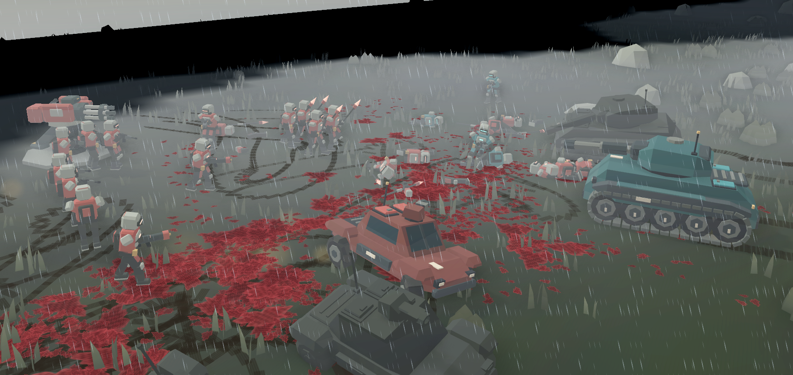

  

  <strong>BUILD. COMMAND. CONQUER.</strong>

# FRONTLINE

### Command the battlefield.

**FRONTLINE** is a low-poly 3D real-time strategy game built with **Godot 4**. Take command of a ground force, capture territory to fund your army, and choose where to concentrate infantry, armor, and artillery.

- **Development milestone** — 0.46 (pre-alpha)
- **Engine** — Godot 4
- **Status** — Active development
- **Languages** — English and Russian

---

## About the Game

Issue army-wide orders to defend, attack, or lay siege. Squads move and engage on their own, while direct orders to individual units or groups let you intervene. In Skirmish, each side begins with a headquarters. Infantry capture resource points, production buildings spend credits to train reinforcements, and destroying the enemy's last headquarters wins the match.

## Gameplay Screenshots

### Battlefield Overview

### Military Operations

### Large-Scale Engagements

*Screenshots captured from the actual game. Work in progress.*

---
## Current Features

- **Army Commands** — Defend ground, choose a pace for an offensive, or contain a base while artillery bombards it. Direct unit orders take priority over the army plan.
- **Combined Arms** — Both sides use the same roster of Power Lancers, Riflemen, Anti-Armor Infantry, Dozor reconnaissance vehicles, Bastion tanks, and Thunder self-propelled guns. Vehicle crews can dismount, capture points on foot, and spend credits on repairs in Skirmish.
- **Territory and Logistics** — Capture resource points to earn credits. Supply posts improve point income, linked relays extend build coverage, and supply depots increase army capacity. Select a unit type at a production building to repeat paid recruitment while credits and capacity allow.
- **Enemy AI and Reconnaissance** — The enemy expands toward nearby points, defends contested approaches, and adjusts production to threats it observes. Fog of war and line of sight govern what you can see and target.
- **Strategic Sites and Progression** — Occupy observation towers to extend vision and secure strongpoints to rally reinforcements or repair vehicles. Units earn veterancy from confirmed kills.
- **Battlefield Atmosphere** — Changing weather and daylight, vehicle tracks, and wrecks show how a battle has unfolded.

### Verified in the development build

- Armies can rally before advancing. Vehicle columns use alternate crossings where available, change lead vehicles, and can halt before a defended crossing while artillery or eligible infantry engage.
- Armor takes different damage from the front, sides, and rear. Weapon and mobility damage affect vehicle performance, while suppressive fire briefly slows infantry.
- Unit panels show equipment and current orders. Numbered control groups are available from the keyboard and minimap. Artillery leaves visible impact marks, and damaged buildings fracture in stages before collapsing.
- **F11** opens Cinematic View in Skirmish or Sandbox. The battle continues with a hidden interface, hidden tactical markers, and weather-responsive ground mist. **F** lowers the camera angle, and **F11** or **Esc** restores the regular view.

## Playable Maps

| Map | Size | Resource points |
| --- | --- | ---: |
| Quiet Valley | 120 × 120 m | 6 |
| River Front | 240 × 240 m | 10 |
| Far Frontier | 480 × 480 m | 14 |

River Front and Far Frontier feature multiple bridges, a wide ford, observation towers, and capturable strongpoints.

## Game Modes

### Skirmish — Playable Prototype

Build from a headquarters, contest resource points, and defeat the opposing commander in a complete match.

### Sandbox — Playable

Experiment with units, construction, and orders in a free-play session.

### Story Campaign — Planned

A narrative mode built around connected military operations.

### Invasion — Planned

A replayable mode built around evolving enemy forces and strategic challenges.

## Development Roadmap

See the [roadmap](ROADMAP.md) for development priorities and the [changelog](CHANGELOG.md) for verified changes.

Current priorities include performance in large battles, more reliable movement and army coordination, and broader balance testing of the AI across the three maps.

## Follow Development

Follow this repository for development updates, gameplay screenshots, and changes to the roadmap.

**FRONTLINE is currently in pre-alpha development. Features, visuals, and plans are subject to change.**

---

*FRONTLINE — Build. Command. Conquer.*
